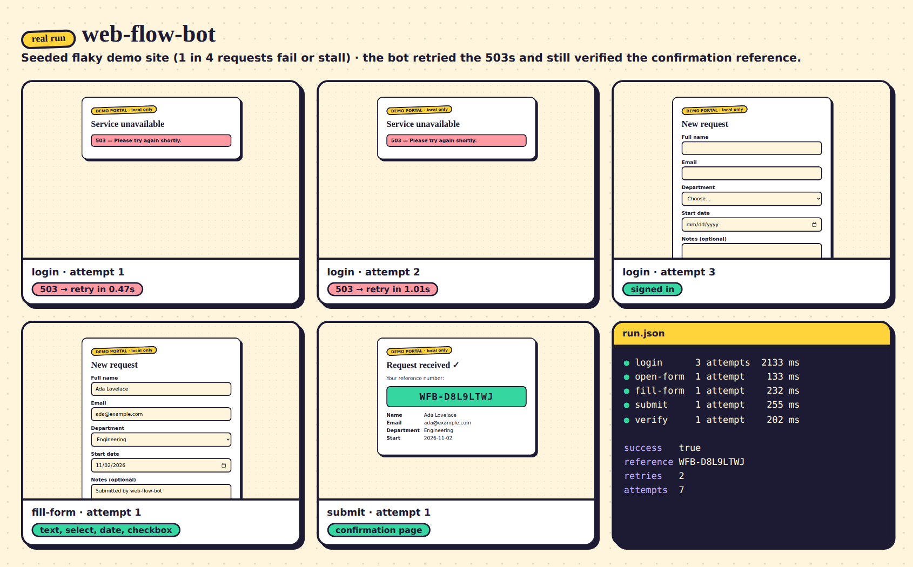

# web-flow-bot

A Playwright bot that logs in, fills a multi-field form, submits it and **verifies the confirmation reference number** — with per-step retries and exponential backoff, a screenshot of every attempt, and a structured JSON run log.

> **It runs against a local demo site** that ships in this repo (FastAPI + plain HTML). It never touches a real third-party website. The demo site can be switched into a flaky mode that fails or stalls about 1 in 4 requests, so the retry logic is exercised for real.



*Above: screenshots and `run.json` from one real run against the flaky demo site (seed 3). The first two login attempts hit a 503; the bot backed off and retried, then completed the flow.*

## Quickstart

```bash
pip install -r requirements.txt && playwright install chromium
cp .env.example .env
python -m bot --spawn-demo-site --flaky --seed 3
```

Add `--headed` to watch the browser. Run artifacts land in `runs/<timestamp>/`.

With Docker (starts the site, waits for its healthcheck, then runs the bot against it):

```bash
docker compose up --build --abort-on-container-exit       # DEMO_FLAKY=1 to make it flaky
```

Run the tests (they start their own demo site on a free port, including flaky mode):

```bash
pytest
```

## What the bot does

| Step | What it does | If it fails |
|---|---|---|
| `login` | opens `/login`, fills credentials from `.env` | bad credentials → fail immediately; 503/timeout → retry |
| `open-form` | opens the form | retry |
| `fill-form` | text, dropdown, date, checkbox, textarea | retry (re-opens the form first) |
| `submit` | clicks submit, waits for the confirmation page | retry (re-opens and re-fills first); validation errors → fail immediately |
| `verify` | reads the reference number, checks it is well-formed, checks the echoed name/email match what was submitted, cross-checks `/api/submissions/<ref>` | **never retried** — a mismatch is a failure, not noise |

## How retries work

Every step runs inside the same wrapper (`bot/runner.py::run_step`):

1. Run the step. On success, take a screenshot and move on.
2. On failure, take a screenshot of what the page looked like, then classify the error:
   - **Transient** (Playwright timeouts, dropped connections, a 5xx error page) → wait, then try again.
   - **Permanent** (bad credentials, the site rejecting the form, a wrong confirmation) → stop at once. Retrying a wrong password only risks a lockout.
   - Anything unexpected is treated as permanent, because retrying a bug hides it.
3. The wait before attempt *n+1* is `min(base_delay × factor^(n-1), max_delay)`, ±`jitter`.
4. If a step has a `recover` action (re-open the form, re-fill it) it runs before each retry, so the page is in a known state.
5. After `max_attempts` the run stops and says which step gave up.

All of it is configurable in `config.yaml`:

```yaml
retry:
  max_attempts: 5
  base_delay: 0.5   # seconds before the 2nd attempt
  factor: 2.0
  max_delay: 8.0
  jitter: 0.1
```

**Is re-submitting safe?** The demo site treats the same user submitting the same data as one record, so a retried submit returns the *same* reference number. One test makes the site process a submit and then answer 503 (a lost response); the bot retries and the site still holds exactly one submission. For a real site you would need the same property (or a way to look the record up) before retrying a submit.

## Sample run log

`runs/<timestamp>/run.json` (full file: [`docs/sample-run.json`](docs/sample-run.json)). Abridged:

```json
{
  "run_id": "20261007-120220",
  "success": true,
  "reference": "WFB-D8L9LTWJ",
  "total_attempts": 7,
  "retries": 2,
  "steps": [
    {
      "name": "login",
      "status": "passed-after-retry",
      "duration_ms": 2133,
      "attempts": [
        {"n": 1, "ok": false, "error": "TransientError: site returned an error page (503)",
         "retryable": true, "backoff_s": 0.474, "screenshot": "01-login-a1-failed.png"},
        {"n": 2, "ok": false, "error": "TransientError: site returned an error page (503)",
         "retryable": true, "backoff_s": 1.009, "screenshot": "02-login-a2-failed.png"},
        {"n": 3, "ok": true, "duration_ms": 244, "screenshot": "03-login-a3.png"}
      ]
    }
  ]
}
```

Passwords are never written to the log or the console (the config object hides them from `repr`, and a test checks the log file).

## Configuration

- `config.yaml` — base URL, timeouts, retry policy and the form data to submit.
- `.env` — credentials (`WFB_USERNAME`, `WFB_PASSWORD`); optionally `WFB_BASE_URL`, `WFB_CHROMIUM_PATH`. Nothing secret is hard-coded; `.env` is git-ignored. `.env.example` has the demo site's throwaway credentials.

CLI flags: `--headed`, `--config`, `--base-url`, `--runs-dir`, `--max-attempts`, `--spawn-demo-site`, `--flaky`, `--seed`.

## The demo site

`python -m demo_site [--flaky]` serves `/login`, `/form`, a submit step and a confirmation page with a reference number (`WFB-XXXXXXXX`). In flaky mode each request has a 25% chance (`DEMO_FLAKY_RATE`) of being slow (longer than the bot's step timeout) or answering 503; for one kind of incident the server does the work *and then* answers 503, to test lost responses. Static files, `/health` and `/api/*` are never disturbed.

## Layout

```
bot/          cli, config, runner (retry wrapper), steps, retry policy, run log, screenshots
demo_site/    FastAPI app, failure injection, idempotent store, templates
tests/        full flow against a local site, flaky mode, retry unit tests, verification failures
Dockerfile    official Playwright Python image, pinned to the same version as requirements.txt
```

## Notes on what was verified

- `pytest` passes locally (23 tests) with Playwright 1.56.0 and Chromium.
- `docker-compose.yml` validates with `docker compose config`; the images themselves were **not built** in the environment this was written in. The Dockerfile uses `mcr.microsoft.com/playwright/python:v1.56.0-noble` — run `docker pull` on it once to confirm the tag exists for you. If you bump `playwright` in `requirements.txt`, bump the image tag to match.
